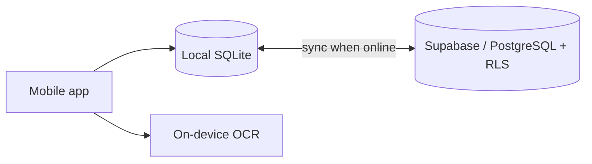

# QuickBill

> A mobile CRM and invoicing app that helps entrepreneurs and WhatsApp/Instagram sellers move from informal to professional invoicing.

**Status:** 🟢 Live on the App Store (Android version in preparation) · 500+ installs · 4.9★
**Origin:** built as my final project for Harvard CS50x.

## Screenshots

   

## Features

- Professional invoices and client management in one app
- Works fully offline: create and edit without a connection
- Automatic sync when the connection returns
- On-device receipt scanning with OCR
- AI-assisted invoicing

## Tech stack

React Native · Expo · TypeScript · expo-sqlite · Supabase (PostgreSQL, Row Level Security) · Tesseract.js

## Architecture

- **Local-first:** all reads and writes hit SQLite, so the app never blocks on the network.
- **Sync engine:** local changes are pushed to Supabase and remote changes pulled when online.
- **Security:** Row Level Security on every table, each user only sees their own data.

## My role

Product design, architecture, full development and App Store release.

> Source code is private. Contact me for a technical walkthrough: nourdevtd@gmail.com
